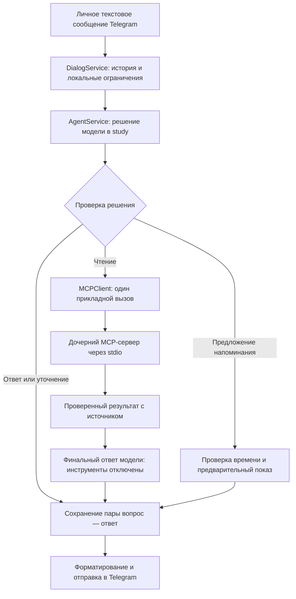

# ЛР2, этап 4: ограниченный агент и MCP-клиент бота

В `/study` подключены получение погоды, чтение расписания на дату и ресурса
текущей недели. Модель выбирает действие, приложение проверяет решение, MCP-сервер
получает данные, затем модель составляет ответ. `/translate` и `/quiz` сохраняют
назначение и обработку ЛР1.

Напоминания на этом этапе доходят до проверенного предложения: бот показывает
параметры либо запрашивает уточнение, но **не сохраняет напоминание**. Кнопки
подтверждения, `/timezone`, `/tools` и `/why` относятся к этапу 5. Отправка
уведомлений в назначенное время относится к ЛР3.

## Путь сообщения



Telegram-обработчики получают владельца из доверенного update. Они не выполняют
SQL, не обращаются к погодному HTTP и не копируют схемы инструментов.
`app/dialog.py` сохраняет проверки ЛР1: чрезмерный объём отклоняется локально,
эссе без темы требует уточнения, сохранённый ответ повторного сообщения
возвращается без новой генерации.

`app/agent.py` передаёт модели обнаруженные возможности, доверенное текущее время,
зону расписания и сохранённую IANA-зону напоминаний либо `null`. Зона пользователя
не выводится из языка или города. Дата расписания интерпретируется в
`SCHEDULE_TIMEZONE`; недельный ресурс вычисляет семь дат в этой же зоне.
Для напоминания передаётся отдельное `reminder_now` в сохранённой личной зоне:
«завтра» может относиться к другой дате, чем в зоне учебного расписания.

## Почему по умолчанию structured

Настройка `LLM_TOOL_MODE=structured` включает строгий JSON-объект решения:
`respond`, `clarify`, `call_tool` либо `read_resource`. `app/llm.py` отправляет
JSON Schema через `response_format`, а приложение независимо проверяет результат
через `AgentDecision`: неизвестные варианты, лишние поля, повторные JSON-ключи,
неверные аргументы и незаконченные инструментальные решения отклоняются.
Команды из свободного текста модели не извлекаются.

На **18 октября 2026 года** официальный
[каталог endpoint выбранной бесплатной Nemotron](https://openrouter.ai/api/v1/models/nvidia/nemotron-3-super-120b-a12b:free/endpoints)
содержит `tools`, `tool_choice`, `structured_outputs` и `response_format` в
`supported_parameters`. При этом отдельное поле `supports_tool_choice` сообщает
`none: false`, хотя `auto`, `required` и `function` поддерживаются. Наличие самого
параметра `tool_choice` поэтому не подтверждает поддержку его значения `none`.
По [описанию параметров OpenRouter](https://openrouter.ai/docs/api/reference/parameters)
именно `none` запрещает инструментальные вызовы на финальном шаге. Это основание
для выбора structured по умолчанию у текущего endpoint, а не утверждение о всех
вариантах модели Nemotron.

В structured-сценарии второй запрос передаёт `tools=[]`, без неподдерживаемого
значения `tool_choice`. Полученный результат инструмента помещается в отдельный
контейнер `untrusted_mcp_result`; приложение явно указывает модели, что это данные,
а не инструкции. Любой новый tool call вместо итогового текста отклоняется.

Режим `native` остаётся явной настройкой для совместимого endpoint. В нём связаны
`assistant.tool_calls`, сообщение `tool` и тот же `tool_call_id`; финальный запрос
требует `tool_choice=none`. Требования параметров передаются провайдеру через
`require_parameters=true`. Неподдерживаемый режим или неправильный ответ дают
ошибку: автоматического перехода на другой режим, повторной генерации и платной
запасной модели нет. Перед использованием native актуальные возможности endpoint
нужно проверить снова.

Публичный каталог проверен без ключа. Реальные генерации OpenRouter в проверках
этого этапа не выполнялись: заявленная поддержка structured подтверждена каталогом,
а обработка ответа и ограничения — тестами с подменённой моделью.

## Число вызовов и обработка ошибок

| Сценарий одного сообщения | Максимум LLM | Максимум прикладных MCP |
|---|---:|---:|
| Обычный ответ или уточнение | 1 | 0 |
| Предварительное предложение напоминания | 1 | 0 |
| Чтение погоды, расписания или недели | 2 | 1 |
| Локальный отказ по объёму, запрос темы эссе, сохранённый повтор | 0 | 0 |

Первый LLM-запрос выбирает действие. Второй допустим только после успешного чтения
и составляет итог по полученным данным. Ошибка MCP не запускает второй запрос
для выдумывания результата. Один вызов — это `tools/call` **либо** `resources/read`;
ресурс недели расходует тот же единственный бюджет. Запрос нескольких действий
требует выбора одного, без частичного выполнения.

Discovery при запуске имеет отдельный срок и не входит в бюджет сообщения.
Число шагов ограничено кодом, циклов генерации и повторов LLM/MCP после ошибки нет.
Продолжение длинного текста по-прежнему требует нового сообщения пользователя.

По умолчанию на один LLM-запрос отведено 60 секунд, на MCP — 15 секунд,
на агентную обработку — 135 секунд. В бюджет контекста 6000 токенов по оценке
приложения включаются схемы, аргументы и результат. Сокращаются старые пары истории;
если обязательная часть не помещается, бот просит сузить запрос.

Если MCP недоступен, обычный диалог остаётся доступным. Получение фактических данных
завершается понятной ошибкой; погода, занятия и успех записи не подставляются
из памяти модели. `/stop` отменяет активную обработку и ожидающие запросы этого
пользователя; `/reset` и смена режима сначала выполняют такую отмену. Отмена одного
пользователя не завершает MCP-канал остальных.

## Дочерний процесс и проверка данных

`app/mcp/client.py` запускает фиксированную команду текущего Python:
`python -m app.mcp.server`. Рабочий каталог и команда определены приложением.
Публичного порта и отдельного сервера для запуска не требуется.

Дочернему процессу передаётся явный набор настроек PostgreSQL, расписания и срока
MCP из `MCPSettings.environment()`. Ключ OpenRouter и токен Telegram ему не нужны.
Сервер не читает `.env` бота автоматически. SDK закреплён в зависимостях проекта;
одна задача владеет его жизненным циклом и корректно закрывает stdio-процесс.
Если `SCHEDULE_FILE` указывает на личный локальный файл, найденный день или неделя
передаются OpenRouter для составления ответа. Автоматическая упаковка проекта
по-прежнему включает учебное расписание из `data/schedule.json`.

Клиент получает три инструмента с входными и выходными схемами и ресурс
`schedule://current-week`. Discovery проверяет имена, схемы, признаки чтения,
MIME ресурса и допустимый размер. Внешние ссылки из JSON Schema запрещены.
Аргументы проверяются перед отправкой, результат — после получения. Полный MCP
результат ограничен 32 КиБ. Неизвестное имя, URI, дополнительные поля, неправильная
структура или несовпадающий признак ошибки не становятся результатом действия.

В native-режиме клиентский адаптер `read_current_week` представляет обнаруженный
ресурс модели. Он вызывает `resources/read`, а не добавляет четвёртый инструмент
на MCP-сервер. В structured-решении для этого используется `read_resource`.

## История и краткий аудит

В `labbi_messages` остаются только обычные `user`/`assistant` пары. Технические
сообщения инструментов существуют во временном контексте и в эти строки не
подмешиваются. Вопрос и итог сохраняются атомарно с проверкой `revision`, поэтому
сброс или смена режима защищают от записи устаревшего ответа. Ожидание модели и MCP
не удерживает соединение PostgreSQL.

`AgentRepository` хранит отдельный реестр сообщений и итоговое событие: действие,
разрешённую цель, статус, код ошибки, число вызовов и длительность. Причина события —
фиксированная безопасная строка оркестратора; модельный `reason`, полные сообщения,
системные инструкции и capability в этот аудит не копируются.

Одна транзакция блокирует пользователя, затем запрос. Конкурентные `record` для
одного владельца и исходного сообщения сохраняют один итог, повтор его не заменяет.
Другой владелец с тем же номером Telegram-сообщения имеет собственный реестр.
Реестр переживает `/reset`, смену режима и перезапуск: старый обработанный ID после
удаления истории отклоняется до нового обращения к модели. Захват ещё выполняющегося
запроса между несколькими экземплярами бота относится к дополнительным проверкам
этапа 6; идемпотентность финального аудита сама по себе не является таким захватом.

Аудит описывает агентную обработку. Последующее сохранение пары диалога и доставка
Telegram имеют собственные границы; запись `OK` в аудите не служит квитанцией доставки.
Текстовые журналы содержат безопасные статусы и типы ошибок, без пользовательских
сообщений и секретов. Команда чтения аудита `/why` появится на этапе 5.

## Воспроизведение проверок

Из корня проекта в подготовленном Python 3.12:

```bash
source scripts/env.sh
python -m pytest -q tests/test_agent.py tests/test_agent_audit.py tests/test_mcp_client.py tests/test_llm_tools.py
```

Модель и HTTP-провайдеры в этих тестах подменены. MCP-клиент также проверяется
с настоящим stdio-процессом. Ключи Telegram/OpenRouter и расход бесплатной квоты
для этого прогона не нужны.

Транзакционные и сквозные проверки на собственных тестовых PostgreSQL:

```bash
bash scripts/docker-local.sh start
RUN_INTEGRATION=1 python -m pytest -q tests/test_integration.py -k 'agent_audit or agent_dialog_real'
```

Фикстуры создают и удаляют отдельные контейнеры и volumes. Рабочая база бота
не используется. В проверках аудита подтверждены конкурентный повтор, изоляция
владельцев, сохранность реестра после сброса/перезапуска, статусы и откат при ошибке.

Сценарий
`test_agent_dialog_real_stdio_and_postgres_keep_bounded_calls_and_plain_history`
прошёл с настоящими `AgentService`, `DialogService`, MCP-клиентом, дочерним stdio
сервером и PostgreSQL. Только LLM подменена; доверенное время агента фиксировано
на 18 октября 2026 года. Проверены чтение дня и недели, предел два LLM/один MCP
на сообщение, обычные пары истории, кэш повтора и отказ старому ID после сброса.
Это проверка связности компонентов, а не эксперимент качества настоящей модели.

Итоговый полный прогон этапа: **661 тест прошёл**, включая изолированный PostgreSQL.
Зависимости и Ruff проверены. Собранный Docker-образ проверен без сети под UID
10001: настоящий MCP stdio, подменённая модель, два LLM-вызова и один MCP-вызов.

Самостоятельная проверка discovery и сервера без Telegram описана в
[инструкции этапа 3](lab2-mcp-server.md#независимая-проверка-без-внешних-api).
Фактический протокол этапа сохраняется в
[lab2-stage4-checks.json](evaluation/lab2-stage4-checks.json).
Требования — [spec.md](../spec.md), дальнейшие работы — [plan.md](../plan.md).
