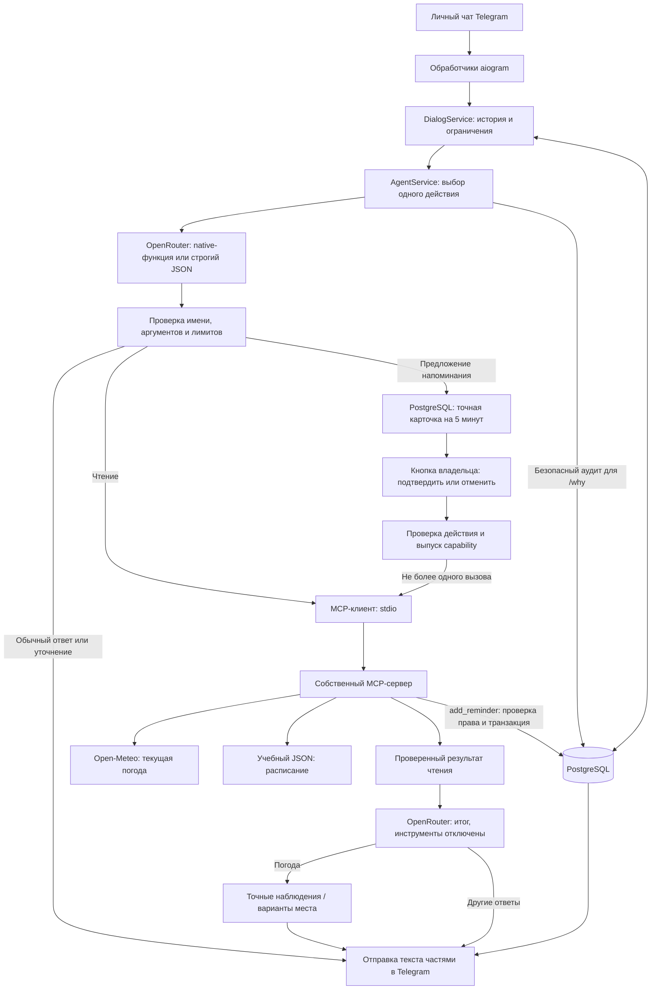

# Отчёт по лабораторной работе № 2

**Telegram-агент с MCP-инструментами — Лабби**

Симанов Арсений Алексеевич, группа М3215.

Дата: 19 октября 2026 года. Репозиторий: [m3215-simanov](https://github.com/Arsushaaa/m3215-simanov).

Обновление от 28 октября 2026 года — [`lab2-final-v3`](https://github.com/Arsushaaa/m3215-simanov/tree/lab2-final-v3).
[Полная приёмка](evaluation/lab2-adversarial-release-20261028.json): **1505 passed,
0 failed, 0 skipped, 28/28 критериев**. [Проверки устойчивости](adversarial-testing.md)
фиксируют 50 реальных LLM-вызовов с сохранением всех неуспехов и стоимостью API 0.
На окончательном коде прошли отдельный погодный поток и восемь новых сценариев;
прежний полный набор из десяти потоков на этом коде повторно не запускался.
Использованы настоящие OpenRouter, MCP stdio и изолированный PostgreSQL,
транспорт Telegram подменён. Все прежние теги и результаты сохраняются.

Исторический семантический срез от 26 октября 2026 года —
[`lab2-final-v2`](https://github.com/Arsushaaa/m3215-simanov/tree/lab2-final-v2):
прежний `lab2-final` был отклонён и сохраняется как история.
[Полный офлайн-протокол](evaluation/lab2-final-v2-release-checks.json): **1390 тестов и 28/28 критериев**;
[ограниченный реальный прогон](evaluation/semantic-routing-smoke-20261026-native-inline/results.json)
дал **6/6 действий и 4/4 наборов аргументов**, шесть LLM-вызовов, стоимость API 0.
Погодное действие перехвачено до MCP, SQL и Telegram не вызывались. Это проверка
шести известных формулировок, отдельно от исторического эксперимента 12/9.
Устройство обновления и все неудачные прогоны описаны в [семантическом сценарии](semantic-routing.md).
Исходные `lab1`, `lab2` и `lab2-final` не перемещаются; старые протоколы ниже
сохраняются как история разработки.

## 1. Цель и результат

Работа продолжает ЛР1, сохранённую тегом `lab1`. Диалоговый бот дополнен
собственным MCP-сервером: агент выбирает получение текущей погоды, чтение
учебного расписания, подготовку напоминания, обычный ответ или уточнение.
Напоминание записывается в PostgreSQL только после подтверждения владельца.
Отправка уведомлений в назначенное время относится к ЛР3.

Требования и принятые решения зафиксированы в [spec.md](../spec.md), этапы —
в [plan.md](../plan.md), правила разработки — в [AGENTS.md](../AGENTS.md).
[Карта приёмки](lab2-acceptance.md) связывает требования с кодом и проверками.

## 2. Архитектура



Бот является MCP-хостом; клиент находится в `app/mcp/client.py`, сервер —
в `app/mcp/server.py`. Бот запускает сервер дочерним процессом через `stdio`,
поэтому отдельный публичный MCP-порт не нужен. Используется официальный
Python SDK 2.3.0 с закреплёнными зависимостями и Python 3.12.

Telegram-обработчики принимают команды, текст и callback, получают владельца
из update и отображают результат. SQL находится в репозиториях, HTTP модели —
в `app/llm.py`, погодный HTTP — в отдельном серверном адаптере.
PostgreSQL хранит историю, настройки, реестр сообщений, действия, напоминания
и безопасный аудит. Вызов LLM не удерживает соединение с БД.

## 3. Контракты инструментов

Клиент обнаруживает входные и выходные схемы через MCP. Имя проверяется
по обнаруженному allowlist; аргументы и результат валидируются локально.
Подробные поля и коды ошибок приведены в [контрактах](../app/mcp/contracts.py)
и [спецификации](../spec.md).

| Возможность | Аргументы | Источник и ограничения |
|---|---|---|
| `get_weather` | `city` на русском | Модель переводит иностранное название и явно указанную страну/регион; текущая погода Open-Meteo; реальная неоднозначность требует уточнения; источник и момент наблюдения входят в ответ |
| `get_schedule` | `date`, `YYYY-MM-DD` | Учебный JSON на 12–25 октября 2026 года; пустой известный день отличается от отсутствия покрытия |
| `add_reminder` | `text`, `remind_at` с offset | Подтверждённое действие в PostgreSQL; владелец и право записи передаются вне аргументов модели |
| `schedule://current-week` | URI ресурса | Только чтение текущей недели по часам сервера и зоне источника |

Данные инструментов считаются недоверенными: текст из источника не меняет
инструкции агента. Файл, URL, SQL, владелец и секреты не являются аргументами
модели. Учебное расписание не содержит персональных занятий пользователя.

## 4. Ограниченный агентный сценарий

Инструменты доступны в `/study`; `/translate` и `/quiz` сохраняют назначение ЛР1.
Программный default — бесплатная `nvidia/nemotron-3-super-120b-a12b:free`;
текущий локальный `.env` явно выбирает `nvidia/nemotron-3.5-super-vl:free`
и `LLM_TOOL_MODE=native`. Платной замены и автоматического fallback нет.
В запросе задана нулевая предельная цена входных и выходных токенов.

Исходный режим `LLM_TOOL_MODE=structured` возвращает один JSON-объект по строгой
схеме; данные [каталога исходного endpoint](evaluation/lab2-provider-evidence.json)
остаются историей. Для новой версии явно выбран `native`: модель выбирает
функцию, приложение проверяет её имя и аргументы каноническим контрактом.
Нативные схемы разворачивают локальные `$ref` во вложенные объекты для
совместимости провайдера, сохраняя строгую проверку результата.
Этот режим проверен реальным ограниченным прогоном. Автоматического
переключения после ошибки нет.

| Сценарий | Максимум LLM | Максимум прикладных MCP |
|---|---:|---:|
| Обычный ответ, уточнение | 1 | 0 |
| Чтение погоды, дня или недельного ресурса | 2 | 1 |
| Подготовка напоминания | 1 | 0 |
| Подтверждение кнопкой | 0 | 1 |

Первый запрос выбирает действие. Второй допускается только после чтения и
формирует ответ с отключёнными инструментами. Составной запрос требует выбора
одного действия. Startup discovery учитывается отдельно. Автоматических повторов
LLM/MCP, цепочки инструментов и продолжения генерации нет; лимиты проверяет код.

В версии `lab2-final-v2` выбор напоминания, уточнения, правки, отмены и
текстового согласия выполняет тот же единственный LLM-запрос по единой схеме;
локальный парсер намерений удалён. `app/reminder_grounding.py` проверяет
дословные пользовательские источники и неизменные поля снимка действующей
карточки. Код проверяет календарь, будущее время, offset и DST; правильность
понимания просьбы владелец сверяет по точной карточке. Подтверждение кнопкой
по-прежнему не вызывает модель. Подробности — [семантическая маршрутизация](semantic-routing.md).

По умолчанию: 60 секунд на LLM, 2048 выходных токена, 135 секунд на обработку,
15 секунд на MCP. Бюджет контекста 6000 учитывает схемы, аргументы и результат;
это приблизительная оценка приложения. Старые пары истории удаляются из контекста
целиком. Чрезмерный объём ответа проверяется локально; готовый текст делится
по ограничению Telegram с сохранением entities. `/stop` отменяет работу владельца.

## 5. Подтверждение, время и надёжность

Пользователь сохраняет IANA-зону командой `/timezone`: доступен прямой ввод,
поиск города и локализованных названий стран с явным выбором. Модель не угадывает
зону. Неизвестная дата или время требуют уточнения. Из пользовательских реплик
проверяются дата и часы; валидируются будущий момент, offset и переходы DST.

Карточка показывает точные текст, дату, время и зону. Подтверждение действительно
пять минут и принимается только от владельца. Текстовое «да» направляет к кнопке.
Отмена, `/stop`, `/reset`, смена режима или зоны отзывают ещё не выполненное действие.
Отдельный `confirmation_epoch` защищает от устаревших кнопок.

После подтверждения выпускается случайная capability не менее 256 бит.
В БД хранится её хеш; исходное значение передаётся отдельным MCP `_meta`,
не попадая в модель, callback или журнал. Сервер под блокировкой проверяет право,
владельца, состояние, epoch, срок и неизменные параметры. Порядок блокировок:
сначала пользователь, затем действие. Уникальность по action ID защищает от дублей.

При тайм-ауте записи бот сверяет тот же action в БД; второй вызов записи
наугад не выполняется. Неизвестный исход не объявляется успехом. Если Telegram
не доставил квитанцию после commit, напоминание остаётся сохранённым;
повтор подтверждения возвращает прежний результат. Однократная доставка Telegram
не гарантируется. Завершённая карточка удаляется после доставки квитанции;
при ошибке удаления приложение пытается убрать кнопки.

`/tools` показывает обнаруженные возможности, `/why` читает безопасный аудит
только владельца: действие, результат, счётчики и короткую причину.
Скрытые рассуждения модели и секреты не выводятся. Миграции `001`–`006`
сохраняются неизменными; схема применяется транзакционно при запуске.

## 6. Эксперимент и автоматические проверки

**Историческое сравнение от 25 октября 2026 года.**
[Сравнение двух бесплатных моделей с фиксированным промптом](evaluation/lab2-comparison.md)
предварительно зарегистрировано в Git и сохраняет все четыре конфигурации.
dots T=0,3: **12/12 действий, 8/9 аргументов** — пороги пройдены;
dots T=0: 11/12, 7/9. Xing не прошла, в двух клетках сохранены 16 отказов 429.
После выбора: 4/4 новых действий, 3/3 аргументов и настоящий MCP-сценарий
с двумя LLM-вызовами. Всего 50 попыток; неизменность входов проверена по hash.
На 25 октября исправления прошли 1312 тестов и все 28 критериев;
последний офлайн-результат указан в начале отчёта. Это сравнение использовало
прежние промпты и схему; оно не измеряет новую семантическую маршрутизацию.
Её отдельные реальные проверки и все неудачи приведены в [новом протоколе](semantic-routing.md).

Три прогона ниже — **история разработки промпта** на том же наборе.
Они не являются независимым сравнением моделей. Исторические результаты
и первоначальные теги сохранены; семантический срез 26 октября обозначен `lab2-final-v2`.

19 октября выполнены три полных прогона неизменных 12 запросов с часами
`2026-10-12T09:00:00+03:00` и зоной `Europe/Moscow`. Выбраны `temperature=0.3`
и те же бюджеты, что в приложении. Используются реальные Dialog/Agent и HTTP
OpenRouter; схема каталога обнаружена через настоящий stdio. Выполнение чтения
перехватывается до IO, напоминание оценивается по валидированному предложению.
Ожидания не передаются модели; для каждого кейса история диалога пуста.

| Прогон | Действия / 12 | Аргументы / 9 | Реальные LLM |
|---|---:|---:|---:|
| Исходный | 7/12 | 5/9 | 11 |
| Правила выбора v1 | 10/12 | 6/9 | 11 |
| Итоговые правила v2 | **12/12** | **9/9** | 11 |

Изменялся один элемент — правила первого промпта: сначала явно разделены день,
неделя, погода и обычный ответ, затем уточнены сохранение указанного места
и вычислимое относительное время. В каждом повторе проверялись все 12 запросов,
включая ошибочные. Все версии сохранены; модель, настройки, схемы и валидаторы
не менялись. Пороги 10/12 и 8/9 пройдены. Всего **33 реальных API-вызова**,
стоимость в usage **0**; один кейс каждого прогона уточняется локально без LLM.
Смысловое качество свободного ответа не входит в эти две метрики.

[Полная методика, таблица и разбор ошибок](evaluation/lab2-experiment.md),
[исходный прогон](evaluation/lab2-results-initial.json),
[промежуточный](evaluation/lab2-results-policy-v1.json),
[итоговый протокол](evaluation/lab2-results.json) содержат исходные видимые решения,
аргументы, API-метаданные и hash исходников. Набор открытый и применялся при
уточнении правил: итог не доказывает качество на независимых неизвестных запросах.

Новые 23 теста измерителя проверяют фиксированные знаменатели, отсутствие
ожиданий в запросе, запрет IO/финальной генерации, неповторение занятых попыток,
безопасное сохранение API-метаданных и отказ при изменении протокола.
Первоначальная приёмка от 19 октября включает тесты ЛР1, настоящий MCP stdio,
24 интеграционные проверки PostgreSQL и матрицу из 28 критериев.
Её итог: **1107 тестов прошли**, ошибок и пропусков нет, все 28 критериев выполнены.
Результат — [lab2-final-checks.json](evaluation/lab2-final-checks.json).
Отдельно сохранены [проверка итогового контейнера](evaluation/lab2-final-container.json)
и [свежий независимый MCP probe](evaluation/lab2-stage7-probe.json): обнаружены
три инструмента и ресурс, прочитаны день/неделя, запись без capability отклонена.
Автотесты используют подменённые Telegram, LLM и погодный HTTP; эксперимент
маршрутизации использует настоящую модель. Показ живого чата выполняется на защите.
Проверенный тогда контейнер работает под UID 10001 без сети и с файловой системой только
для чтения; MCP прочитал учебный день. Hash `app/agent.py` совпадает с исходником
принятого эксперимента, все шесть миграций включены в образ.
[Проверка материалов](evaluation/lab2-artifacts-checks.json) фиксирует валидность
JSON/ссылок, исключение локальных данных и отсутствие совпадений с известными
длинными секретами в сдаваемых файлах.

```bash
source scripts/env.sh
python -m scripts.lab2_reliability --output .deploy/evaluation/lab2-checks.json
python -m scripts.mcp_probe --date 2026-10-12
python -m scripts.lab2_experiment --env-file .env --output .deploy/evaluation/lab2-repeat.json
```

Последняя команда расходует бесплатную квоту при новом пути результата.
Docker нужен для интеграционных тестов; эксперимент не подключается к PostgreSQL.

## 7. Использование AI и проверка предложений

Codex применялся для анализа задания, проектирования контрактов и границ,
написания кода, тестов и документации. NVIDIA Nemotron через OpenRouter использовалась
в исходном боте и исторических прогонах. Контролируемое сравнение выполнено
на бесплатных dots и Xing. Новая маршрутизация проверена на бесплатной
`nvidia/nemotron-3.5-super-vl:free` в режиме `native`; эта конфигурация явно
выбрана в локальном `.env`. Пример `.env` и программные defaults остаются
прежними, поэтому при чистом запуске нужны оба переопределения:
`OPENROUTER_MODEL=nvidia/nemotron-3.5-super-vl:free` и `LLM_TOOL_MODE=native`.
Ожидаемые ответы эксперимента не передаются модели. Секреты не включаются
в запросы, журнал диалога и сдаваемые материалы.

Пример отклонённого предложения: автоматическое продолжение длинной генерации
вызвало поток лишних сообщений. По замечанию пользователя оно отменено;
продолжение требует нового пользовательского запроса. Для ЛР2 закреплены
программные ограничения числа обращений и запрет новых инструментов в финале.

Исторический пример исправления в ЛР2: реальный ответ модели выразил выбранное
пользователем местное время через UTC; первоначальная проверка ошибочно отклонила
этот момент. Тогда добавлены нормализация к сохранённой IANA-зоне и локальная
сверка параметров. [Протокол ошибки и контролируемого воспроизведения](evaluation/lab2-live-bugfix-model.json)
сохраняет исходный результат. В новой семантической версии источники проверяет
`reminder_grounding.py`, календарные ограничения — код, а смысл даты — владелец
по карточке; прежний парсер намерений удалён.
Эти примеры показывают необходимость проверки предложений AI кодом и наблюдаемыми
результатами. Ответ модели сам по себе не подтверждает корректность программы.

## 8. Запуск, демонстрация и ограничения

Команды запуска и ключи описаны в [локальном окружении](local-environment.md).
[Сценарий защиты](lab2-defense.md) содержит порядок показа, независимый MCP-клиент,
подтверждения, повторные события, `/why` и проверку отказов.

Бесплатный endpoint зависит от общей квоты аккаунта и внешней сети.
В прежней конфигурации dots один тестовый перевод воспроизводимо отклонялся HTTP 400;
приложение сообщает об отказе запроса, точная причина фильтрации не подтверждена.
[Диагностика](provider-rejections.md) отделяет это ограничение от исправлений бота.
Погода текущая; прогноз на произвольный день не реализован. Учебное расписание
имеет фиксированное покрытие и не является личным расписанием студента.
Напоминания сохраняются без доставки по времени. Зоны стран распознаются
на 43 языках CLDR, поиск городов зависит от Open-Meteo. Качество свободного
текста и любого будущего запроса не гарантируется результатами малого эксперимента.

## Источники

- [Методические указания, ЛР2](labs-guide.md#lab2).
- [Официальный Python MCP SDK](https://github.com/modelcontextprotocol/python-sdk).
- [MCP: stdio](https://modelcontextprotocol.io/specification/2025-11-25/basic/transports),
  [инструменты](https://modelcontextprotocol.io/specification/2025-11-25/server/tools),
  [ресурсы](https://modelcontextprotocol.io/specification/2025-11-25/server/resources).
- [Open-Meteo](https://open-meteo.com/en/docs).
- [Публичный каталог выбранного endpoint](https://openrouter.ai/api/v1/models/nvidia/nemotron-3-super-120b-a12b:free/endpoints),
  проверен 19 октября 2026 года.
