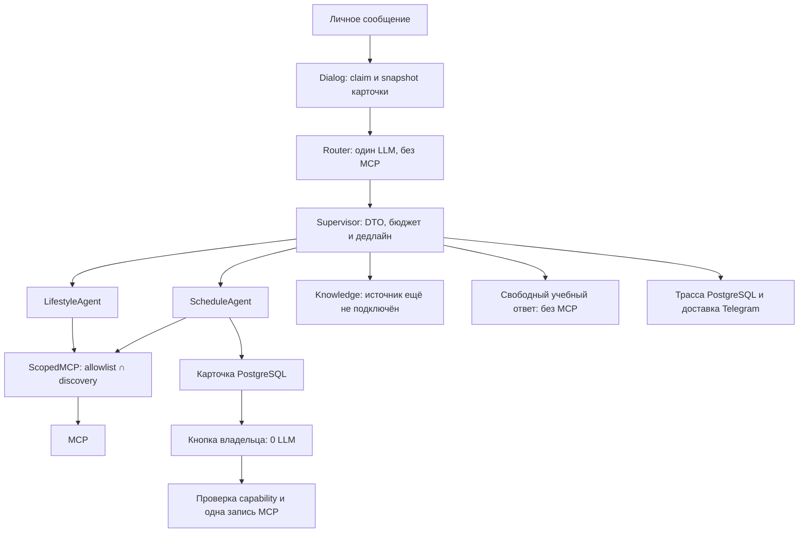

# ЛР3, этап 2: маршрутизация, права и трассы

Это описание состояния этапа 2 и его приёмки. На этапе 3 заглушка Knowledge
заменена [поиском по материалам](lab3-materials.md); исторические числа ниже сохранены.

Новый запуск `python -m app` использует Supervisor. В `/study` один семантический
Router предлагает RouteDecision, затем код выбирает ровно одного специалиста.
Регулярных выражений для выбора намерения нет. Неизвестная цель, лишние поля,
обрыв JSON, несколько native calls и дубли полей означают уточнение без исполнителя.
Повторной генерации и возврата к старому агенту со всеми инструментами нет.

Schedule и Lifestyle используют отдельные инструкции, схемы и ScopedMCP;
Lifestyle получает только последние две пары истории и не получает служебный
снимок pending_card. Schedule сохраняет историю, необходимую для дословных источников
напоминания. Router получает последние две пары, исходный запрос, доверенные часы,
зону и факт наличия карточки; ID владельца и capability в модель не передаются.
Knowledge пока возвращает явное SOURCE_UNAVAILABLE. Настоящий поиск — этап 3.

| Путь | LLM максимум | Прикладные MCP максимум |
|---|---:|---:|
| Уточнение Router | 1 | 0 |
| Свободный учебный ответ | 2 | 0 |
| Погода/расписание | 3 | 1 |
| Подготовка/правка карточки | 2 | 0 |
| `/translate`, `/quiz` | 1, без Router | 0 |
| Подтверждение кнопкой | 0 | 1 |

Budget резервируется перед вызовом. Router ограничен 30 секундами, Supervisor —
165 суммарно; локальный лимит AgentService сохраняется. MCP-политика проверяется
непосредственно перед call/read, на текущем снимке discovery. Новые названия
не разрешаются автоматически. MCP-клиент обновляет каталог по уведомлению сервера
и раз в 60 секунд; несовместимая входная схема отключает только данный инструмент. User-query scope никогда не вызывает add_reminder,
даже если получил похожий на capability словарь. Отдельный callback scope Schedule
проверяет форму capability; настоящую авторизацию и неизменные параметры по-прежнему
проверяет MCP-сервер транзакционно в БД. Confidence не даёт дополнительных прав.

`begin_semantic_request` вызывается до Router. Пока смысл нового запроса неизвестен,
старую карточку нельзя подтвердить, включая ранее выданную capability. Неясное действие,
отмена и сбой отзывают карточку прежним механизмом epoch; обычный успешный разговор
сохраняет её. Подготовка и пара вопрос/карточка сохраняются одной транзакцией.
AgentResult конструирует приложение по наблюдённым вызовам и проверенным фактам.
Статус needs_confirmation и action ID появляются после фактической подготовки в БД.

`007_tracing.sql` создаёт две таблицы: заголовки с владельцем и закрытые TraceSpan.
Там нет сообщений, промптов, аргументов, адресов доставки, секретов и скрытых рассуждений.
Родитель span связан составным внешним ключом с той же трассой и request ID.
ContextVar изолирует параллельные запросы. Записи выполняются короткими запросами,
соединение PostgreSQL не удерживается во время LLM/MCP/Telegram.

`/trace last` и `/trace <UUID>` показывают этапы, статусы, длительности и usage
провайдера; отсутствие usage означает неизвестное значение, а не нулевой расход.
Просмотр не создаёт новую трассу. Отмена помечается cancelled, ошибка доставки —
failed; ошибки после генерации не запускают новую LLM. Сначала сохраняется заголовок,
так что незавершённая попытка не подменяется старым успехом. Незавершённые заголовки
старше десяти минут при чтении становятся interrupted: это истечение окна наблюдения,
а не доказательство, что внешняя отправка точно не состоялась.
Если первичная запись трассы недоступна, запрос останавливается до LLM с сообщением
о недоступности БД. Ошибка финальной записи оставляет незавершённую трассу и безопасный
лог класса ошибки. Неподдержанные/отклонённые до выполнения callback и неизвестные
команды не создают трассу действий. ACK и индикатор набора не считаются доставкой ответа.

Проверки: `tests/test_supervisor.py`, `test_tracing.py`, расширенные `test_llm.py`
и два новых PostgreSQL-сценария в `test_integration.py`. Они проверяют фактический
запрет вызова чужого MCP, смену discovery, общий бюджет, native/structured Router,
изоляцию родителей/владельцев, перезапуск pool, ошибку Telegram, отсутствие текстов
в метаданных и блокировку старой карточки во время Router. Исходные 15 заданий
не изменялись; реальные LLM-запросы и Telegram HTTP на этом этапе не выполнялись.
Полный протокол: [lab3-stage2-regression.json](evaluation/lab3-stage2-regression.json).
Результат: **1634 passed, 0 failed, 0 skipped**, включая **45 новых тестов** и
все прежние **28 критериев ЛР2**. [Сводка этапа](evaluation/lab3-stage2-checks.json)
содержит список новых тестов и хеши runtime. Старый тест клиента эксперимента
обновлён под поле output_tokens=5 из уже существующего mock-ответа провайдера;
входы экспериментов, наблюдения, знаменатели и пороги не менялись.
Это не результат будущего живого эксперимента и не гарантия отсутствия ошибок модели.

Миграция применяется автоматически при запуске. Docker копирует весь `app`,
а облачный архив собирает Python рекурсивно и все SQL из migrations — новые
модули и 007 попадают в оба варианта. Новых зависимостей и переменных `.env` нет.
Команду `/trace` можно добавить в меню BotFather; приложение обрабатывает её сразу.
Старые сдаваемые теги сохранены. Уведомления по времени пока не отправляются.

## После дополнительной проверки ложных действий

Schedule без фактического чтения/подготовки/отзыва не возвращает свободную прозу
как результат действия: приложение показывает неизменяемое описание возможностей.
Сохранённые reminders не удаляются и не переносятся; cancel_reminder относится
только к существующей pending. Уточнения о времени/дате/тексте/зоне выбирает LLM
из конечных вопросов, код проверяет выбранный вопрос в обоих API-режимах.
Это не парсер слов пользовательского запроса. Host-only needs_clarification
переносит такой исход в AgentResult и аудит. LLM/MCP-бюджеты прежние.

## Улучшение native-решения Schedule

В актуальном native Schedule первый decide требует одну функцию через
require_tool=True/tool_choice=required. Explain_schedule_scope — локальная пустая
функция без аргументов текста и без MCP, для честного объяснения ограничений.
Другие роли и legacy сохраняют auto. Это не повтор генерации и не дополнительный
шаг. Бесплатный endpoint проверен по открытому каталогу. Подсказки источников
параметров короткие, только в Schedule; канонические DTO и legacy-контекст прежние.

## Замечания преподавателя, 4 ноября

Router в native требует `select_route` (`tool_choice=required`), без нового вызова
модели или повтора. Конкретная учебная тема, сравнение или просьба повторить тему
достаточны для учебного маршрута; отсутствие пожеланий по уровню/формату не требует
уточнения. Локального извлечения интента по регуляркам нет. Некорректный DTO теперь
отображается как ошибка выбора маршрута и `failed/INVALID_ROUTE`, отдельно от
семантического `clarify`. Два исходных вопроса преподавателя в диагностическом
прогоне уже дали `legacy_study`: прежний сбой оказался невоспроизводимым в этих
двух попытках. Полный новый опыт и границы вывода — в отчёте
[teacher-feedback-20261104.md](evaluation/teacher-feedback-20261104.md).
