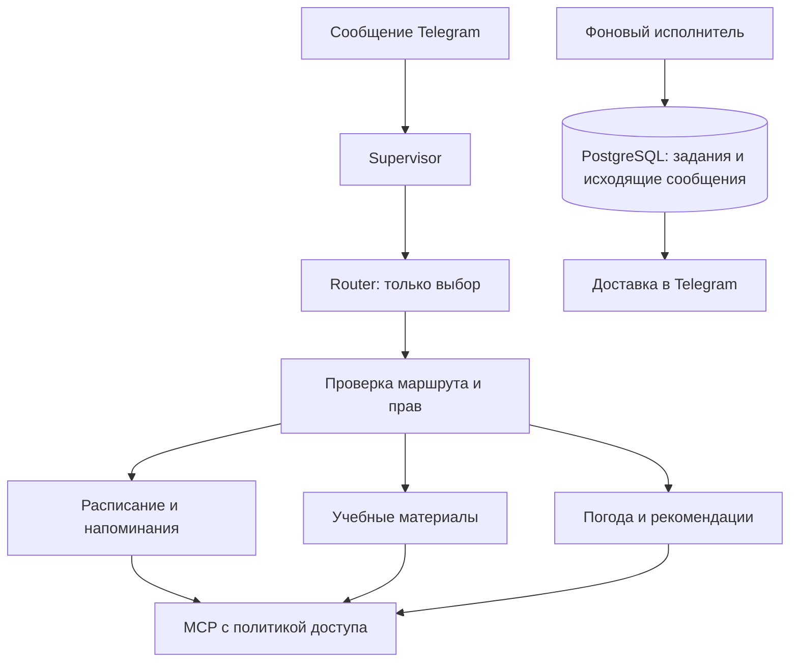

# ЛР3: предлагаемый план для Лабби

Статус на 2 ноября 2026 года: **все восемь этапов выполнены**.
**Условный прогресс: 8/8 — выполнено 100%, осталось 0%.** Объём этапов различается.
База — неизменяемый тег `lab2-final-v4`. Реализованы Router/Supervisor,
три специалиста, материалы, профиль/согласие, доставка и ежедневная сводка.
[Финальная приёмка](evaluation/lab3-quality-release-checks-20261102.json):
**1890/0/0, 34/34 критерия, release_ready=true**.
[Финальный реальный эксперимент v8](evaluation/lab3-experiment-v8.md):
**15/15**. Новые формулировки — **4/4**. Прежние ошибки v6 сохранены отдельно.
[Свободная атакующая переписка](lab3-security.md) нашла утечку инструкций
через QuizTurn.feedback и ошибку перевода; оба исправления перепроверены.
Дополнительная атакующая сессия нашла и исправила ложное обещание отмены уже
сохранённого напоминания. Один короткий ответ о времени был безопасно отклонён
и остаётся сохранённым неуспехом; полный запрос восстановил карточку.
[Улучшение качества](evaluation/lab3-quality-improvement-20261102.md) проверило
уточнения времени и обязательный native-выбор Schedule; лишний запрос даты
остаётся замечанием. Отчёт и демонстрация готовы. Версия для сдачи — локальный аннотированный `lab3-final-v3`; `lab3` и `lab3-final-v2` сохранены.

Актуальные [требования](labs-guide.md#lab3) и [15 случаев](evaluation/lab3-routing.json)
импортированы из upstream без изменения вопросов и ожиданий. Commit/blob/hash
указаны в [снимке](evaluation/lab3-source.json). Разделы ЛР1/ЛР2 методички
проверены на побайтовое совпадение; вне ЛР3 добавились якоря и приложения.

[Спецификация](lab3-spec.md) фиксирует выбранные решения, а
[constitution.md](../constitution.md) — границы безопасности.
[Матрица](evaluation/lab3-acceptance-cases.json) содержит planned-сценарии,
а не отметки о якобы выполненных функциях.

| Этап | Статус |
|---|---|
| 1. Требования, DTO, правила и критерии | Выполнен |
| 2. Router, специалисты, права и трассы | Выполнен |
| 3. Материалы и MCP-поиск | Выполнен |
| 4. Город, настройки и очередь | Выполнен |
| 5. Доставка и восстановление | Выполнен |
| 6. Ежедневная сводка | Выполнен |
| 7. Общая приёмка и эксперимент | Выполнен: полная регрессия, 34/34, реальный v8 15/15 и живая перепроверка исправлений |
| 8. Отчёт и сдача | Выполнен: отчёт, таблица, защита, образ/архив, health200 и локальный тег lab3-final-v3 |

## Предлагаемое устройство

Оставить один Python-процесс, PostgreSQL и stdio MCP. Разделить ответственность
внутри приложения; все специалисты могут пользоваться выбранной бесплатной моделью.
Router предлагает цель, Supervisor проверяет DTO и допускает исполнителя.

Предлагаемые границы модулей: `routing/`, `agents/`, `materials/`, `notifications/`,
`tracing/`. Имена уточняются при первом этапе; ради структуры не нужно переписывать
готовые репозитории и обработчики. `app/llm.py` остаётся HTTP-границей модели.

Выбрана цель `legacy_study` к прежнему свободному учебному ответу без MCP.
Она не даёт доступа к старому AgentService со всеми инструментами. Knowledge
отвечает только по материалам, `/translate` и `/quiz` обходят новый Router.
Точные маршруты и границы — в [спецификации](lab3-spec.md#1-границы-компонентов).

## Этап 1. Спецификация, контракты, критерии — выполнен

Обновлены корневые spec/plan, создана constitution. Добавлены проверяемые
RouteDecision, AgentRequest, типизированный AgentResult и TraceSpan в
[contracts.py](../app/routing/contracts.py). Закрыты лишние поля и неизвестные
цели, заданы конечные confidence, IANA/aware-время и явная проекция контекста
без ID. Facts переиспользуют проверенные MCP-модели и не подтверждают сами по себе права.

Проверяются неизвестные маршруты, попытки передать actor/destination из модели,
невалидные facts, ложный успех, поля трассы, поля подтверждения и небезопасные
экземпляры DTO. Итог документных/контрактных проверок сохраняется отдельно
в [lab3-stage1-checks.json](evaluation/lab3-stage1-checks.json).
Полная регрессия: 1589 успешных тестов, без ошибок/пропусков, включая 61 новый;
сохранены все 28 критериев ЛР2. Нулевой расход реальных LLM/Telegram.
Ни миграции, ни старые теги не изменены. Новый runtime и политика вызовов
остаются этапом 2, запланированные сценарии не засчитаны за пройденную приёмку.

## Этап 2. Router, специалисты, политика и трасса — выполнен

Подключены `app/routing/router.py`, `supervisor.py`, `policy.py`,
`app/agents/specialists.py` и `app/tracing/`. Новая миграция — `007_tracing.sql`;
001–006 не меняются. `/trace last` и `/trace <UUID>` читают только трассы владельца,
сама команда просмотра не становится новой последней трассой.
Knowledge до этапа 3 честно сообщает SOURCE_UNAVAILABLE и не вызывает другой агент.
Фактические проверки и ограничения описаны в [lab3-orchestration.md](lab3-orchestration.md).
Полная регрессия: 1634/0/0, включая 45 новых тестов, прежние 28/28 критериев.
[Протокол этапа 2](evaluation/lab3-stage2-checks.json) хранит список новых проверок,
хеши runtime и ссылку на полную регрессию. Реальных LLM/Telegram HTTP — ноль.

Ниже сохранены требования этапа:

Выделить из AgentService проверенное поведение расписания/напоминаний и погоды.
Сохранить существующие источники параметров, карточки, capability и проверку владельца.
Router не получает MCP. Политику проверять в общей точке непосредственно перед
каждым вызовом: пересечение известного каталога и явного списка компонента.
Новые серверные инструменты не должны автоматически становиться разрешёнными.

| Компонент | Разрешённые MCP-возможности |
|---|---|
| Router | Нет |
| Schedule | `get_schedule`, `add_reminder`, `schedule://current-week` |
| Knowledge | `search_materials`, `materials://catalog` |
| Lifestyle | `get_weather` |
| BriefingService | Чтение через соответствующих специалистов, без записи |

`confidence` сохранять для анализа, не считать подтверждением или разрешением.
`/stop` отменяет запросы владельца и его неподтверждённые действия, но не гасит
общий worker и не удаляет уже сохранённые напоминания.

Добавить отдельное хранилище трасс, например миграцией `007_tracing.sql`.
Не складывать суммарные три LLM-вызова в прежнюю таблицу с CHECK до двух:
старый аудит относится к прежнему агентному шагу, новая трасса — ко всему запросу.
Служебную связь с владельцем хранить для изоляции; тексты сообщений и промптов
в атрибуты трассы не переносить. Добавить `/trace last` и просмотр своей трассы по ID.

Проверки: неизвестный маршрут, невалидный DTO, подмена ID, отказ в чужом инструменте
и ресурсе, новый инструмент в discovery, доступ другого пользователя, отмена.

## Этап 3. Локальные учебные материалы — выполнен

Добавлены три собственных документа, реестр версий, bounded lexical search,
`search_materials`, `materials://catalog` и KnowledgeAgent. Каталог реально читается
через MCP при запуске; поиск и ссылки сверяются по схемам/ID/версиям.
Код проверяет ссылки и цитаты; неверный итог заменяется проверенными выдержками,
а пустая выдача не дополняется общими знаниями модели. Подробности и фактические
проверки — [lab3-materials.md](lab3-materials.md). Новых миграций/зависимостей нет.
Полная регрессия: **1695/0/0**, включая **61 новую проверку**, прежние **28/28 критериев**.
[Протокол этапа](evaluation/lab3-stage3-checks.json) содержит список новых тестов,
хеши кода/корпуса, границы и ссылку на полный прогон. Реальных LLM-запросов — ноль.

Ниже сохранены требования этапа:

Предлагаю три собственных обезличенных текста: основы MCP; контекст LLM и
структурированный вывод; идемпотентность и восстановление доставки.
Дать им постоянные ID и версии. Для маленького корпуса начать с ограниченного
локального текстового поиска; векторная БД и платные embeddings пока не нужны.

Добавить `search_materials` и `materials://catalog`. Каталог действительно прочитать
через MCP, проверить и передать Knowledge Agent. Поиск возвращает только ограниченные
фрагменты и ID из реестра. Пользователь не задаёт путь; ссылки в ответе проверяются
по реально найденным документам. Пустая выдача приводит к отсутствию ответа
в материалах, а не к дополнению из общей памяти модели.

Проверки: нет совпадений, границы размера, неверный ID, traversal, подмена каталога,
инструкция внутри документа. Остальные специалисты каталог не получают.

## Этап 4. Настройки уведомлений, город и очередь PostgreSQL — выполнен

Реализация: `app/notifications/`, миграция `008_notifications.sql`,
четыре новые команды и callback города. Меню сохраняет hash токена, TTL и версию
профиля. Адрес регистрируется по личному update. Задание напоминания создаётся
SQL-триггером в той же транзакции, что напоминание; сводка пока имеет только
API подготовки задания без планировщика. Point-ветка MCP погоды доступна коду
Lifestyle, а пользовательский LLM по-прежнему получает только city.
[Устройство и проверки](lab3-notification-settings.md).
Полная регрессия: **1747/0/0**, включая **52 новые проверки**, прежние **28/28 критериев**.
[Протокол](evaluation/lab3-stage4-checks.json) содержит границы, список тестов и
хеши runtime; реальные LLM/Telegram/погодные HTTP не использовались.

Ниже сохранены требования этапа:

Следующей миграцией, например `008_notifications.sql`, добавить настройки,
подтверждённое место и исходящие задания. Согласие на сводку по умолчанию выключено.
Адрес личного чата брать только из update и хранить отдельно от идентификатора
владельца; значение ID владельца не использовать как неявный адрес отправки.

Реализовать `/city`, `/briefing_on`, `/briefing_off`, `/notifications`.
Для города показать реальное место и сохранить координаты по кнопке владельца.
Существующее меню часовых поясов и логику одноимённых городов переиспользовать.
Погодному адаптеру потребуется чтение подтверждённой точки: контракт для этой
операции определить отдельно, чтобы координаты профиля не подменялись моделью
и не геокодировались заново с произвольным выбором.

В исходящем задании предложить: ключ события, тип, владелец, адрес, подготовленный
текст, состояние, число попыток, срок следующей попытки, срок захвата, код ошибки.
Ключ напоминания связан с существующим reminder ID; ключ сводки — с владельцем
и локальной датой. UNIQUE обеспечивает одну подготовку, а не ровно одну сетевую отправку.

Проверки: чужая кнопка, отмена выбора, настройки до подтверждения, нет зоны,
изменение согласия/города во время подготовки, две последовательные и конкурентные записи.

## Этап 5. Доставка напоминаний и восстановление — выполнен

Подключены `delivery_models.py`, `delivery_repository.py`, `worker.py`,
миграция `009_delivery_receipts.sql`. Worker запускается вместе с polling и
завершается перед закрытием Telegram/БД; его остановка отражается в healthcheck.
Журнал попыток сохраняется до HTTP, stale lease не меняет новую попытку,
payload не генерируется повторно. `/notifications` показывает безопасные счётчики.
[Реализация, проверенные сбои и ограничения](lab3-reminder-delivery.md).
Полная регрессия: **1806/0/0**, 59 новых проверок, прежние 28/28 критериев.
[Фактический протокол](evaluation/lab3-stage5-checks.json). Закрыто 5/8 этапов (62,5%), осталось 37,5%.

Ниже сохранены требования этапа:

Предлагаю фоновую asyncio-задачу с коротким периодическим чтением PostgreSQL.
Состояние работы хранить в БД, а не в таймерах процесса. Задания захватывать
транзакционно; возможный механизм — `FOR UPDATE SKIP LOCKED` с ограниченным lease.
Во время Telegram HTTP соединение с БД не удерживать. При shutdown завершать
исполнителя до закрытия Telegram и пула. После старта подбирать просроченные leases.

Уже подтверждённое напоминание не требует нового Router или LLM. Прошедший срок
обрабатывать по политике задания: задержка до 15 минут допускается с пометкой,
дальше `missed`. Заранее сохранённый текст переиспользовать при доставке.
На временные ошибки — максимум три попытки всего, например первая сразу,
повторы через 30 и 120 секунд с учётом ответа сервиса и срока актуальности.
Постоянная ошибка завершает задание. Не обещать полное отсутствие дублей после
неопределённого сетевого исхода; отдельно показать это ограничение в отчёте.

Проверки: fake clock, будущее время, границы опоздания, отказ Telegram,
исчерпание попыток, конкурентный worker, перезапуск после подготовки и отправки.

## Этап 6. Ежедневная сводка — выполнен

Полная регрессия: **1834/0/0**, 28 новых тестов, прежние 28/28 критериев.
[Фактический протокол](evaluation/lab3-stage6-checks.json).

Реализация: [lab3-daily-briefing.md](lab3-daily-briefing.md), миграция 010.
Ниже исходные требования этапа:

Предлагаю отдельный BriefingService. На 08:00 пользовательской зоны он получает
занятия, напоминания этого дня, погоду подтверждённой точки и учебный фокус.
Событие имеет локальную дату и сохраняется до отправки. Применять окно опоздания
60 минут; прошлые дни не рассылать пачкой. Перед отправкой снова проверить согласие.

Вызовы сервисов чтения выполнять с общим дедлайном. Отказ одного раздела не должен
отменять остальные. Учебный фокус выбирать из проверенного корпуса и кэшировать
по версии материалов/теме: сводка не должна создавать бесконечную генерацию.
Пустое расписание, отсутствие покрытия и отказ источника показывать по-разному.

Нынешний учебный файл покрывает 12–25 октября: для живой демонстрации нужен
новый обезличенный период или локальный персональный источник. Исходную фикстуру
и часы обязательного эксперимента сохранить отдельно.

## Этап 7. Общая приёмка и реальная проверка маршрутизации

Тесты писать и выполнять по каждому завершённому этапу. Здесь собрать итог:
старые режимы, постановка и доставка, восстановление, согласие, профиль,
частичные отказы, приватность трасс и все границы политик.
Фиктивные LLM/MCP/Telegram, управляемое время и настоящая отдельная БД позволяют
проверять сбои без бесплатной квоты и личной переписки.

Для эксперимента импортировать исходные 15 случаев без правки ожиданий.
Зафиксировать модель, T, контекст, источники, лимиты и проверяющий код до API.
Ориентир приёмки — 12/15 маршрутов. Шесть сценариев безопасности проверять
по реальным попыткам запрещённых вызовов в тестовых адаптерах; текст отказа
не является доказательством. Все ошибки и исходные знаменатели сохранять.

Прогон по модели и повтор после одного обоснованного изменения — разные
заранее регистрируемые протоколы. Не расходовать квоту на повторение одинаковых
попыток в поисках удачного результата. Проверять остаток до запуска.

## Этап 8. Отчёт, запуск и версия для сдачи

Подготовить `docs/lab3-report.md`, демонстрацию, схемы маршрутизации и доставки,
фактическую таблицу прав, результаты и границы восстановления. Объяснить внутренние
контракты и способ будущего перехода к A2A. Отдельный A2A-сервис, внешняя система
трасс и погодные оповещения каждый час в первоначальный объём не включать.

Проверить упаковку новых SQL/данных в Docker и деплой, настройки запуска,
секреты и совместимость. После фактической приёмки создать новый `lab3`,
сохранив `lab2-final-v4` и более ранние теги.

## Предлагаемые бюджеты LLM и эксплуатации

Router добавляет работу относительно ЛР2. Для специализированного чтения
предлагается максимум 1 Router + 2 LLM специалиста, один прикладной MCP;
для подготовки карточки — 1 + 1, callback и доставка готового напоминания — 0.
Это предложение для новой спецификации ЛР3, а не уже изменённый предел ЛР2.
Старые `/translate` и `/quiz` продолжают свой прежний одиночный вызов.
Автоматического продолжения текста и скрытых перегенераций не добавлять.

Briefing использует явные операции чтения и сохранённые параметры без Router,
а не отправляет сводку обратно в пользовательский диалог. Предлагаю ограничить
его тремя MCP-чтениями и максимум одной LLM на учебный фокус с кэшем; фактическую
схему и пределы зафиксировать при проектировании DTO и проверить тестами.

Для одного сквозного эксперимента из 15 входов верхняя оценка — 39 LLM,
включая Router; не запускать дополнительно ещё один такой набор ради отдельной
таблицы Router. Ошибочные случаи и безопасность по большей части воспроизводить
подменёнными адаптерами. Реальный бюджет назначается до API; текущая подготовка
плана вообще не обращается к модели бота.

Разработка может идти локально. Постоянные своевременные уведомления потребуют
постоянно работающего процесса и PostgreSQL; это может быть включённый компьютер
или существующая ВМ. Перевод в облако не является первым шагом.

Источники выбранных механизмов: [asyncio Python 3.12](https://docs.python.org/3.12/library/asyncio-task.html),
[захват строк PostgreSQL](https://www.postgresql.org/docs/current/sql-select.html#SQL-FOR-UPDATE-SHARE).
