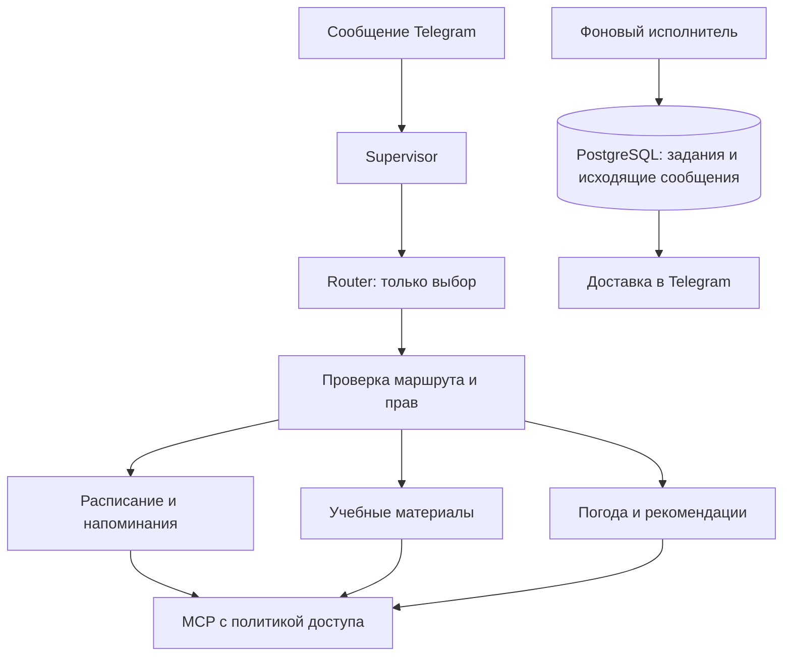

# ЛР3: предлагаемый план для Лабби

Статус: проект плана, 1 ноября 2026 года. Реализация не начата.
База — неизменяемый тег `lab2-final-v4`. Это предложение по развитию проекта,
а не отчёт о выполненной работе. План не запускает модель или уведомления.

Источники: [актуальное условие](https://github.com/LegionerSV/itmo-tg-template/blob/main/docs/labs-guide.md#lab3)
и [15 исходных случаев](https://github.com/LegionerSV/itmo-tg-template/blob/main/docs/evaluation/lab3-routing.json).
Проверенные Git blob: методичка `cb29e0caaf357fe6bdd83f689f6f33da168cf015`,
набор `e9ce1c8447f1bc6d5c670b1fe9912d515d2722c4`.
Локальный `labs-guide.md` пока содержит старую заглушку; его нельзя считать
актуальным источником ЛР3. Перед реализацией нужно импортировать обновлённые
учебные документы отдельным коммитом и проверить изменения предыдущих разделов.

## Предлагаемое устройство

Оставить один Python-процесс, PostgreSQL и stdio MCP. Разделить ответственность
внутри приложения; все специалисты могут пользоваться выбранной бесплатной моделью.
Router предлагает цель, Supervisor проверяет DTO и допускает исполнителя.

Предлагаемые границы модулей: `routing/`, `agents/`, `materials/`, `notifications/`,
`tracing/`. Имена уточняются при первом этапе; ради структуры не нужно переписывать
готовые репозитории и обработчики. `app/llm.py` остаётся HTTP-границей модели.

Для сохранения обычных учебных ответов предусмотреть отдельный путь к прежнему
DialogService, без новых инструментов. Если он выбирается через Router, явно
разрешить техническую цель `legacy_study` в нашем контракте и описать её как
адаптер прежнего режима. Knowledge Agent при этом не превращается в универсального
собеседника без источников. `/translate` и `/quiz` сохраняют прежний путь.
Это решение нужно закрепить до изменения обработчиков.

## Этап 1. Спецификация, контракты, критерии

Обновить `spec.md`, `plan.md`, подготовить `constitution.md`. Разделить поля,
которые предлагает модель, и поля доверенного приложения. Задать DTO маршрута,
запроса, результата и события трассы. Зафиксировать совместимость старых режимов,
тайм-ауты, пределы обращений, поведение отмены и неизвестного маршрута.

Зафиксировать список проверок до кода. Не менять завершённые миграции `001`–`006`,
исторические протоколы, теги или входные случаи ради новой архитектуры.

Результат: согласованное устройство и матрица проверок, а не новые обещания бота.

## Этап 2. Router, специалисты, политика и трасса

Выделить из AgentService проверенное поведение расписания/напоминаний и погоды.
Сохранить существующие источники параметров, карточки, capability и проверку владельца.
Router не получает MCP. Политику проверять в общей точке непосредственно перед
каждым вызовом: пересечение известного каталога и явного списка компонента.
Новые серверные инструменты не должны автоматически становиться разрешёнными.

| Компонент | Разрешённые MCP-возможности |
|---|---|
| Router | Нет |
| Schedule | `get_schedule`, `add_reminder`, `schedule://current-week` |
| Knowledge | `search_materials`, `materials://catalog` |
| Lifestyle | `get_weather` |
| BriefingService | Чтение через соответствующих специалистов, без записи |

`confidence` сохранять для анализа, не считать подтверждением или разрешением.
`/stop` отменяет запросы владельца и его неподтверждённые действия, но не гасит
общий worker и не удаляет уже сохранённые напоминания.

Добавить отдельное хранилище трасс, например миграцией `007_tracing.sql`.
Не складывать суммарные три LLM-вызова в прежнюю таблицу с CHECK до двух:
старый аудит относится к прежнему агентному шагу, новая трасса — ко всему запросу.
Служебную связь с владельцем хранить для изоляции; тексты сообщений и промптов
в атрибуты трассы не переносить. Добавить `/trace last` и просмотр своей трассы по ID.

Проверки: неизвестный маршрут, невалидный DTO, подмена ID, отказ в чужом инструменте
и ресурсе, новый инструмент в discovery, доступ другого пользователя, отмена.

## Этап 3. Локальные учебные материалы

Предлагаю три собственных обезличенных текста: основы MCP; контекст LLM и
структурированный вывод; идемпотентность и восстановление доставки.
Дать им постоянные ID и версии. Для маленького корпуса начать с ограниченного
локального текстового поиска; векторная БД и платные embeddings пока не нужны.

Добавить `search_materials` и `materials://catalog`. Каталог действительно прочитать
через MCP, проверить и передать Knowledge Agent. Поиск возвращает только ограниченные
фрагменты и ID из реестра. Пользователь не задаёт путь; ссылки в ответе проверяются
по реально найденным документам. Пустая выдача приводит к отсутствию ответа
в материалах, а не к дополнению из общей памяти модели.

Проверки: нет совпадений, границы размера, неверный ID, traversal, подмена каталога,
инструкция внутри документа. Остальные специалисты каталог не получают.

## Этап 4. Настройки уведомлений, город и очередь PostgreSQL

Следующей миграцией, например `008_notifications.sql`, добавить настройки,
подтверждённое место и исходящие задания. Согласие на сводку по умолчанию выключено.
Адрес личного чата брать только из update и хранить отдельно от идентификатора
владельца; значение ID владельца не использовать как неявный адрес отправки.

Реализовать `/city`, `/briefing_on`, `/briefing_off`, `/notifications`.
Для города показать реальное место и сохранить координаты по кнопке владельца.
Существующее меню часовых поясов и логику одноимённых городов переиспользовать.
Погодному адаптеру потребуется чтение подтверждённой точки: контракт для этой
операции определить отдельно, чтобы координаты профиля не подменялись моделью
и не геокодировались заново с произвольным выбором.

В исходящем задании предложить: ключ события, тип, владелец, адрес, подготовленный
текст, состояние, число попыток, срок следующей попытки, срок захвата, код ошибки.
Ключ напоминания связан с существующим reminder ID; ключ сводки — с владельцем
и локальной датой. UNIQUE обеспечивает одну подготовку, а не ровно одну сетевую отправку.

Проверки: чужая кнопка, отмена выбора, настройки до подтверждения, нет зоны,
изменение согласия/города во время подготовки, две последовательные и конкурентные записи.

## Этап 5. Доставка напоминаний и восстановление

Предлагаю фоновую asyncio-задачу с коротким периодическим чтением PostgreSQL.
Состояние работы хранить в БД, а не в таймерах процесса. Задания захватывать
транзакционно; возможный механизм — `FOR UPDATE SKIP LOCKED` с ограниченным lease.
Во время Telegram HTTP соединение с БД не удерживать. При shutdown завершать
исполнителя до закрытия Telegram и пула. После старта подбирать просроченные leases.

Уже подтверждённое напоминание не требует нового Router или LLM. Прошедший срок
обрабатывать по политике задания: задержка до 15 минут допускается с пометкой,
дальше `missed`. Заранее сохранённый текст переиспользовать при доставке.
На временные ошибки — максимум три попытки всего, например первая сразу,
повторы через 30 и 120 секунд с учётом ответа сервиса и срока актуальности.
Постоянная ошибка завершает задание. Не обещать полное отсутствие дублей после
неопределённого сетевого исхода; отдельно показать это ограничение в отчёте.

Проверки: fake clock, будущее время, границы опоздания, отказ Telegram,
исчерпание попыток, конкурентный worker, перезапуск после подготовки и отправки.

## Этап 6. Ежедневная сводка

Предлагаю отдельный BriefingService. На 08:00 пользовательской зоны он получает
занятия, напоминания этого дня, погоду подтверждённой точки и учебный фокус.
Событие имеет локальную дату и сохраняется до отправки. Применять окно опоздания
60 минут; прошлые дни не рассылать пачкой. Перед отправкой снова проверить согласие.

Вызовы сервисов чтения выполнять с общим дедлайном. Отказ одного раздела не должен
отменять остальные. Учебный фокус выбирать из проверенного корпуса и кэшировать
по версии материалов/теме: сводка не должна создавать бесконечную генерацию.
Пустое расписание, отсутствие покрытия и отказ источника показывать по-разному.

Нынешний учебный файл покрывает 12–25 октября: для живой демонстрации нужен
новый обезличенный период или локальный персональный источник. Исходную фикстуру
и часы обязательного эксперимента сохранить отдельно.

## Этап 7. Общая приёмка и реальная проверка маршрутизации

Тесты писать и выполнять по каждому завершённому этапу. Здесь собрать итог:
старые режимы, постановка и доставка, восстановление, согласие, профиль,
частичные отказы, приватность трасс и все границы политик.
Фиктивные LLM/MCP/Telegram, управляемое время и настоящая отдельная БД позволяют
проверять сбои без бесплатной квоты и личной переписки.

Для эксперимента импортировать исходные 15 случаев без правки ожиданий.
Зафиксировать модель, T, контекст, источники, лимиты и проверяющий код до API.
Ориентир приёмки — 12/15 маршрутов. Шесть сценариев безопасности проверять
по реальным попыткам запрещённых вызовов в тестовых адаптерах; текст отказа
не является доказательством. Все ошибки и исходные знаменатели сохранять.

Прогон по модели и повтор после одного обоснованного изменения — разные
заранее регистрируемые протоколы. Не расходовать квоту на повторение одинаковых
попыток в поисках удачного результата. Проверять остаток до запуска.

## Этап 8. Отчёт, запуск и версия для сдачи

Подготовить `docs/lab3-report.md`, демонстрацию, схемы маршрутизации и доставки,
фактическую таблицу прав, результаты и границы восстановления. Объяснить внутренние
контракты и способ будущего перехода к A2A. Отдельный A2A-сервис, внешняя система
трасс и погодные оповещения каждый час в первоначальный объём не включать.

Проверить упаковку новых SQL/данных в Docker и деплой, настройки запуска,
секреты и совместимость. После фактической приёмки создать новый `lab3`,
сохранив `lab2-final-v4` и более ранние теги.

## Предлагаемые бюджеты LLM и эксплуатации

Router добавляет работу относительно ЛР2. Для специализированного чтения
предлагается максимум 1 Router + 2 LLM специалиста, один прикладной MCP;
для подготовки карточки — 1 + 1, callback и доставка готового напоминания — 0.
Это предложение для новой спецификации ЛР3, а не уже изменённый предел ЛР2.
Старые `/translate` и `/quiz` продолжают свой прежний одиночный вызов.
Автоматического продолжения текста и скрытых перегенераций не добавлять.

Briefing использует явные операции чтения и сохранённые параметры без Router,
а не отправляет сводку обратно в пользовательский диалог. Предлагаю ограничить
его тремя MCP-чтениями и максимум одной LLM на учебный фокус с кэшем; фактическую
схему и пределы зафиксировать при проектировании DTO и проверить тестами.

Для одного сквозного эксперимента из 15 входов верхняя оценка — 39 LLM,
включая Router; не запускать дополнительно ещё один такой набор ради отдельной
таблицы Router. Ошибочные случаи и безопасность по большей части воспроизводить
подменёнными адаптерами. Реальный бюджет назначается до API; текущая подготовка
плана вообще не обращается к модели бота.

Разработка может идти локально. Постоянные своевременные уведомления потребуют
постоянно работающего процесса и PostgreSQL; это может быть включённый компьютер
или существующая ВМ. Перевод в облако не является первым шагом.

Источники выбранных механизмов: [asyncio Python 3.12](https://docs.python.org/3.12/library/asyncio-task.html),
[захват строк PostgreSQL](https://www.postgresql.org/docs/current/sql-select.html#SQL-FOR-UPDATE-SHARE).
