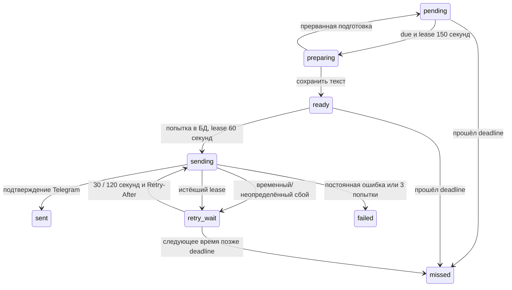

# ЛР3, этап 5: доставка напоминаний

`ReminderWorker` запускается вместе с polling, проверяет PostgreSQL примерно раз
в пять секунд и работает только с `kind=reminder`. Отдельных таймеров на каждую
запись, обращений к модели и MCP здесь нет. Для доставки нужен работающий процесс
и зарегистрированный из личного update адрес. Локального запуска достаточно для
демонстрации; постоянная работа требует включённого ПК или сервера.

Партия ограничена десятью записями, одновременно выполняются до двух HTTP-вызовов.
Lease на отправку выдаётся после получения свободного слота. Ожидающие задачи
не удерживают lease, и нет задачи на каждое напоминание в базе. Захват подготовки
и восстановление используют `FOR UPDATE SKIP LOCKED`; проверка перед отправкой
использует блокировки user → profile → outbox. Соединение освобождается до HTTP.
Просроченные старые записи не вытесняют актуальные из партии отправки.

Сначала сохраняется готовый текст с исходным плановым временем и зоной; опоздание
помечается при подготовке. Повтор сохраняет тот же payload. Текст отправляется
буквально, с parse_mode=None, без предпросмотра ссылок и платного broadcast.
Размер проверяется в единицах UTF-16 Telegram; обычное напоминание до 500 символов
с помещающимся заголовком укладывается в одно сообщение. Частичной отправки нет.

До HTTP транзакционно записываются номер попытки, token/version lease, trace ID
и started_at. Миграция `009_delivery_receipts.sql` добавляет журнал попыток,
квитанцию Telegram и признак неопределённости. Старые 001–008 не меняются.
Финальная сверка проверяет текущее состояние, lease, адрес и deadline. Нельзя
начать HTTP раньше due или позже due+15 минут; граница 15 минут включительна.
Если начатый вовремя HTTP завершился позже, полученный успех честно сохраняется
как sent. Это не новая попытка после deadline.

Временные ошибки сети/5xx и тайм-аут дают повтор. Первая задержка — 30 секунд,
вторая — 120; Retry-After может увеличить их. Больше трёх зарезервированных попыток
не бывает, включая перезапуски. Если следующая попытка не помещается в окно,
задание становится missed. Forbidden/Unauthorized/BadRequest завершают задание.
Ошибка не вызывает отдельного сообщения пользователю о сбое. В логах — только
фиксированный код и класс ошибки, без тела ответа, URL, текста, ID и токенов.

Устаревший worker не может завершить текущую попытку другого исполнителя.
Поздний ACK может дописать только квитанцию собственной попытки; уже известную
квитанцию нельзя заменить другой. Текущий исполнитель/восстановление использует
известный успех без нового HTTP. Если Telegram принял сообщение, но квитанция
вообще не сохранилась, после восстановления **возможен дубль**. У sendMessage нет
общего внешнего ключа идемпотентности. uncertain отмечает такой риск, а failed
при неопределённости означает остановку попыток, не доказательство недоставки.

Готовый текст и счётчики переживают перезапуск. Истёкший lease подготовки позволяет
подобрать то же задание; истёкшая отправка сохраняет неизвестный исход и соблюдает
оставшийся бюджет. `/stop`, сброс и смена режима останавливают диалог, а не уже
подтверждённые напоминания. При shutdown worker прекращает новые захваты, дожидается
активных отправок и завершается до Telegram/пула. Healthcheck учитывает liveness;
неожиданное завершение worker завершает приложение для перезапуска контейнера.

`/notifications` показывает собственные счётчики очереди и сетевую неопределённость.
Трассы подготовки/попыток не содержат текста уведомления; журнал связывает их
с событием внутренним UUID. Код не отправляет ещё не реализованные сводки.
Подписка `/briefing_on` остаётся настройкой следующего этапа.

Проверки — tests/test_reminder_delivery.py и четырнадцать PostgreSQL-сценариев
в test_integration.py: успех, отсутствие соединения при HTTP, два worker, окна
времени, временные/постоянные ошибки, три попытки, Retry-After, старый lease,
поздний ACK, потерянная фиксация, неизменный payload, backlog, чужой trace,
смена адреса, восстановление после reset/restart, игнорирование briefing,
shutdown и падение worker. Telegram — подмена; реальных LLM/API Telegram нет.

Полный протокол — `docs/evaluation/lab3-stage5-regression.json`. Неуспех после
удлинения промпта сохранён в `lab3-stage5-regression-initial.json`: два прежних
напоминания не помещались в контекст. Исправлено реальное правило runtime — оно
сокращено, лимиты и сценарии не ослаблены. Исторические эксперименты/теги сохранены.

После обновления нужно перезапустить приложение; миграция применится автоматически.
Новые команды, ключи, переменные окружения и зависимости этому этапу не нужны.
Ежедневная сводка, живой эксперимент и окончательный отчёт — следующие этапы.
