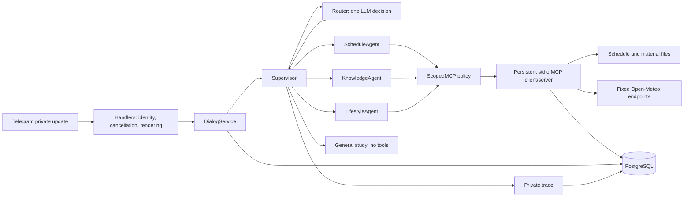
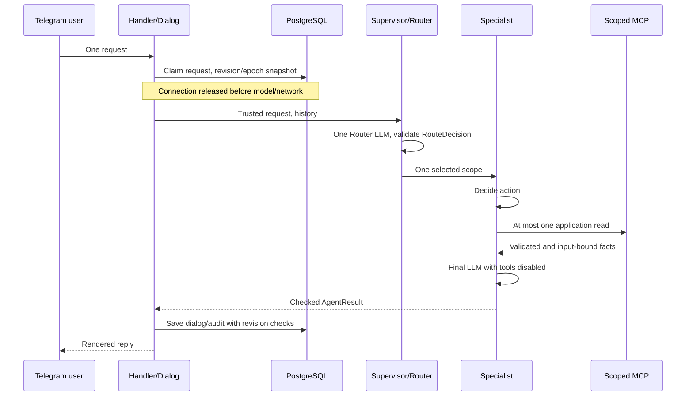
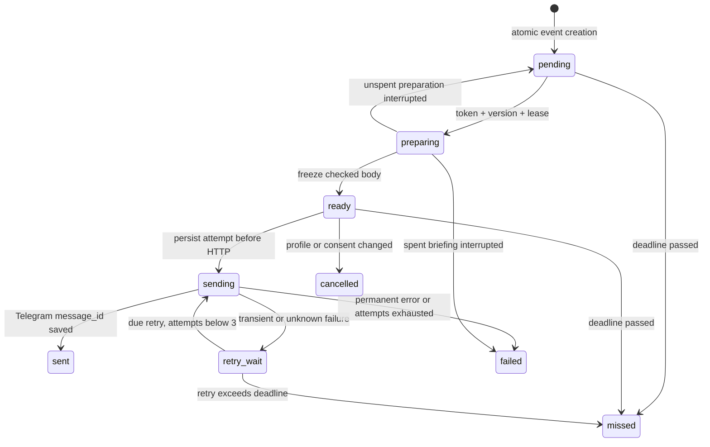

# Лабораторная работа № 3: специалисты и проактивный помощник

**Симанов Арсений Алексеевич, М3215.** Проект «Лабби».
Репозиторий: [Arsushaaa/m3215-simanov](https://github.com/Arsushaaa/m3215-simanov).
Основание: [снимок методички](evaluation/lab3-source.json), upstream
`8346faedd1a4b7ab1a47419065da5a89ea7474fd`.

**Статус:** реализация и автоматические проверки готовы; обязательный реальный
эксперимент пока не выполнен из-за квоты. Финальный тег `lab3` пока **не создан**.
До заполнения экспериментальной части эту версию нельзя считать полностью
прошедшей приёмку. Историческая сдаваемая ЛР2 — `lab2-final-v4` — сохранена.

## 1. Цель и продукт

Цель — разделить учебного Telegram-помощника на специалистов с разными правами,
добавить ответы по локальным учебным материалам и проактивные уведомления,
сохранив управляемые затраты, изоляцию пользователей и восстановление после сбоев.

Бот принимает личные текстовые сообщения через long polling. Режим `/study`
использует семантический Router, Supervisor и одного специалиста. `/translate`
и `/quiz` сохраняют прежние отдельные сценарии. Температуру можно установить
любым конечным числом от 0 до 1. `/reset` очищает диалог, `/stop` отменяет
генерации и неподтверждённые действия владельца, а не глобальную доставку.

Напоминание сначала показывается точной карточкой. Только кнопка владельца
разрешает запись. Сохранённое напоминание доставляется к заданному времени.
Ежедневная сводка по отдельному согласию в 08:00 содержит занятия, напоминания,
текущую погоду подтверждённого города и один учебный фокус с источником.

## 2. Компоненты и обычный запрос

Уточнение не запускает частичное исполнение нескольких действий. Ошибочный DTO
не означает переход к более широкому старому агенту. Неизвестный tool/resource
отклоняется, даже если сервер внезапно добавил его в discovery.

## 3. Специалисты, инструкции и права

| Компонент | Назначение инструкции | Прикладные MCP-права |
|---|---|---|
| Router | Выбрать одну цель по смыслу; цитаты — данные; confidence не разрешение | Нет |
| Schedule | Занятия и точная подготовка/правка карточки | get_schedule, schedule://current-week; add_reminder только отдельному подтверждённому callback |
| Knowledge | Только найденные материалы, проверяемые ссылки и цитаты | search_materials, materials://catalog |
| Lifestyle | Текущая погода и рекомендации по полученным фактам | get_weather; point только host-чтению сводки |
| General study | Прежние учебные объяснения без внешних действий | Нет |
| BriefingService | Системная сборка разделов без Router | Чтение через три перечисленных scope; записи нет |

Политика находится непосредственно перед MCP-вызовом: пересечение фиксированного
allowlist и текущего discovery. Пользовательская генерация не может записать
напоминание даже через Schedule с произвольной capability. Подтверждение отдельно
проверяет владельца, эпоху и реальные параметры БД. Пользователь, модель и документы
не задают SQL, файл, URL, адрес Telegram или идентичность владельца.

Обычный специализированный запрос ограничен **3 LLM / 1 MCP**: Router, выбор
специалиста, финал чтения. Карточка — до 2 LLM / 0 MCP, кнопка — 0 LLM / 1 MCP,
готовое напоминание — 0 LLM / 0 MCP, перевод и quiz — 1 LLM. Общий дедлайн
Supervisor — 165 секунд; скрытых повторов и автоматического продолжения нет.
Это новая граница ЛР3; исторический код тегов ЛР2 с пределом 2 LLM не изменялся.

## 4. Фактические контракты

Канонический код — [routing/contracts.py](../app/routing/contracts.py).
DTO запрещают лишние поля и повторно проверяют полученные экземпляры.

- `RouteDecision`: target из schedule/knowledge/lifestyle/legacy_study/clarify,
  соответствующий фиксированный reason и конечный confidence 0..1. Идентичности
  и аргументов инструментов здесь нет.
- `AgentRequest`: request_id, trace_id, actor_id, исходный text, intent,
  occurred_at и timezone. Создаётся приложением. `model_context()` исключает ID
  и адрес; intent пользовательского запроса и системного запуска не берётся из текста.
- `AgentResult`: та же пара request_id/trace_id, status, сообщение, confidence,
  типизированные facts, фактически использованные tools/resources и error_code.
  Supervisor сверяет идентичность и наблюдение MCP; самодекларация агента не факт.
- MCP имеет строгие входные/выходные схемы. Дата расписания, точка погоды и
  идентичность поиска сверяются с запросом. Версии/ID материалов проверяются
  по реально загруженному каталогу, а не по строке ссылки модели.

Это вызовы Python внутри одного процесса, **не реализация A2A**: нет сетевого
A2A transport, обнаружения внешнего агента или межсервисной аутентификации.
Возможное развитие — первым вынести KnowledgeAgent: оставить DTO и политику
на границе, добавить отдельный аутентифицированный transport и связывание задачи
с request/trace, затем реализовать выбранный A2A-протокол. Тайм-аут, отмена,
проверка источников и запрет записи должны сохраниться при сетевом переносе.

## 5. Материалы и заземление

Корпус — три собственных обезличенных документа: назначение MCP, контекст LLM
и структурированный вывод, идемпотентность и восстановление доставки.
Реестр содержит постоянные ID, SHA-256 версий и digest каталога. Каталог читается
через `materials://catalog` при старте и сравнивается с локальным ожидаемым снимком.
Knowledge получает его, другие роли — нет.

Для маленького корпуса достаточно ограниченного лексического поиска без внешних
embeddings и дополнительной БД. Файлы не выбираются путём пользователя; проверяются
размеры, UTF-8, symlink и хеш. Поиск ограничен пятью документами/фрагментами.
Пустая выдача означает отсутствие ответа в источнике, а не разрешение ответить
из памяти. Финал требует известный ID и дословную цитату. Неверный JSON/ссылка/
цитата заменяется выдержкой без нового LLM. Это проверяет происхождение, но
не доказывает абсолютную смысловую корректность каждого пересказа.

## 6. Профиль и проактивная сводка

`/city` ищет реальные варианты, показывает предварительную карточку и сохраняет
координаты только по кнопке владельца. Нельзя выбрать крупный город вместо
неоднозначного маленького по населению. Город и пользовательская IANA-зона —
разные настройки. Адрес доставки регистрируется из проверенного private update,
а не выводится из actor_id. Подписка по умолчанию выключена.

Сводка вычисляет 08:00 по локальной календарной дате, не прибавляет 24 часа к UTC.
Задание уникально по `(user_id, local_date)`. Согласие после сегодняшних 08:00
начинает действие завтра. Допускается опоздание до 60 минут включительно,
прошлые дни после простоя не отправляются пачкой. Версия профиля меняется при
смене города, зоны, адреса или согласия; устаревшее задание отзывается.

ScheduleAgent читает текущий день, LifestyleAgent — подтверждённую точку,
KnowledgeAgent — фрагмент выбранного документа. Напоминания владельца читаются
из SQL в пределах его локального дня. В модель не передаются личные напоминания,
история и адрес доставки. Каждый источник ограничен ожиданием, ошибка раздела
не отменяет остальные. Пустой день, дата вне покрытия и недоступный источник
показываются разными сообщениями. В тексте есть время подготовки и зона.

Максимум **3 MCP / 1 LLM** на подготовку, резервирование коммитится до API.
Материал выбирается детерминированно по дню из отсортированных ID. Кэш по
`(catalog_version, topic)` общий и содержит только публичный фокус/источник.
Это уменьшает расход квоты и даёт стабильный результат после перезапуска.
Только один создатель кэша вызывает LLM; конкурентный/прерванный использует
выдержку. Потраченная прерванная подготовка не генерируется заново. Готовый текст
сохраняется и при Telegram-повторах не меняется.

Демонстрационный файл `data/schedule-demo.json` покрывает 2–15 ноября 2026 года.
Это вымышленное расписание, не личные занятия автора. Исходная октябрьская
фикстура и часы обязательного эксперимента остались неизменны.

## 7. Outbox, доставка и восстановление

Миграции 007–010 добавляют трассы, профиль/меню, outbox, квитанции и кэш.
Ранее применённые миграции не переписываются. Outbox содержит UUID события,
владельца, отдельный адрес, тип, reminder_id либо local_date, снимок версии/зоны,
сроки, замороженный body, состояние, attempts, next_attempt_at, lease-token/version,
счётчики API и фиксированный код ошибки. Журнал попытки сохраняется **до HTTP**.

Worker читает ограниченные партии, не держит БД во время сети, одновременно
отправляет максимум два сообщения. Lease захватывается после освобождения слота.
Старый token/version не может изменить новую попытку. Потеря записи квитанции
восстанавливается по тому же событию; известный ACK не создаёт новую отправку.
После перезапуска просроченные leases разбираются по прежней записи.

Напоминание не отправляется заранее; до 15 минут опоздания помечается задержкой,
после — missed. Для временной ошибки максимум три попытки всего: первая и повторы
через 30/120 секунд, с учётом Retry-After и актуальности. Постоянная ошибка
завершает задание. Для сводки применяется её часовой срок. Некорректный payload
не отправляется. Один текст ограничен 4096 UTF-16; уведомления идут без parse mode
и без платного broadcast. Shutdown сначала останавливает worker, затем Telegram/БД.

**Остаточный риск:** Telegram sendMessage не имеет универсального ключа
идемпотентности. Если сообщение принято, но ACK потерян до фиксации в БД,
повтор может дать дубль. UNIQUE события защищает внутреннее задание, но не делает
сетевую доставку exactly-once. Такая неопределённость сохраняется и видна в
`/notifications`; тест специально воспроизводит возможный дубль того же body.

## 8. Трасса и приватность

`/trace last` и `/trace <UUID>` возвращают только трассу владельца. Просмотр
не заменяет последнее действие. Поля span замкнуты: компонент, операция, статус,
время/длительность, разрешённый tool/resource/target, confidence, usage, ID
материалов и cache_hit. Тексты, промпты, capability, env и Telegram identity
в атрибуты span не попадают. Связь владельца хранится отдельно для SQL-изоляции.

[Пример настоящих spans контролируемого теста](evaluation/lab3-trace-example.json),
не переписка пользователя (LLM/MCP подменены, ID удалены). Пример цепочки:
`supervisor/receive → router/route → schedule/agent → schedule/model_decide →
schedule/tool_call(get_schedule) → schedule/model_final → telegram/send_message`.
Последний span добавляет handler при доставке ответа; прямой вызов Supervisor
его не создаёт. Численные токены без usage не оцениваются и остаются неизвестными.
Результат подготовки уведомления и результат его отправки имеют разные трассы.

## 9. Автоматическая приёмка

Завершённые этапы: 1589 → 1634 → 1695 → 1747 → 1806 → 1834 теста.
После исправлений безопасности: **1842 passed, 0 failed, 0 skipped**, прежние
28/28 критериев. [Полный результат](evaluation/lab3-security-regression.json).
Финальный прогон дополнительно включает измеритель и упаковку:
[lab3-final-checks.json](evaluation/lab3-final-checks.json): **1851/0/0**,
33/34 критерия; один отсутствующий — реальный routing_experiment.

Матрица [lab3-acceptance-matrix.json](evaluation/lab3-acceptance-matrix.json)
связывает 34 критерия с конкретными node ID либо реальным экспериментом.
Приёмка не засчитывает отсутствующие или пропущенные тесты. Настоящие отдельные
PostgreSQL проверяют рестарты, конкуренцию и изоляцию. SDK/stdio MCP запускается
реально; внешние Telegram, модель и погодный HTTP в автоматических тестах
подменены для воспроизводимых ошибок. Это не UI-проверка Telegram.

В финальной приёмке также сохранён [первоначальный неуспешный прогон](evaluation/lab3-final-checks-initial.json):
1848/1/0. Исправлена проверка пула: один SQL-ресурс доступен внутри каждого
внешнего callback, а не требование полного простоя при параллельных источниках.
Параллельная подготовка двух сводок дополнительно защищает lease второго задания.

История ошибок разработки сохранена: этап 3 имел исправленный первоначальный
прогон; на этапе 5 длинное уточнение промпта переполнило контекст двух старых
сценариев — правило сокращено без правки сценариев. Успешный повтор не выдаётся
за единственную существовавшую попытку.

## 10. Реальная маршрутизация

[Протокол](evaluation/lab3-experiment-v2.md) и JSON зафиксированы коммитом `8e3041c`
до API. После исправления параллельности сводок, до первого вызова, создан
отдельный v2 с новым hash: прежний протокол и checkpoint 0 попыток сохранены.
Модель NVIDIA Nemotron 3.5 Super VL free, native, T=0.2, max_tokens=2048,
контекст 6000, reasoning off. Все 15 исходных запросов, пустая история,
12.10.2026 09:00 Europe/Moscow. Ожидания не передаются Router. Порог 12/15.
Нет подбора промпта под результаты, скрытых повторов или исключения HTTP-ошибок.
Usage и cost сохраняются, только если реально сообщены провайдером.

**Результат пока отсутствует:** ключ сообщает 49/50 использованных запросов;
измеритель остановился до генераций. 0 начатых попыток не означает качество 0/15
или успешную приёмку. Статус — incomplete. [Checkpoint](evaluation/lab3-experiment-v2-results.json).
Полная таблица в [приложении](evaluation/lab3-routing-table.md); заполняется
только после реального прогона. Если будут ошибки, анализ каждого и отдельная
предрегистрация исправления должны сохранить исходную попытку и знаменатель 15.

## 11. Шесть атак

[Фактические проверки](lab3-security.md), [машинный протокол](evaluation/lab3-security-checks.json).

| Атака | Ожидание | Фактически |
|---|---|---|
| Прямое игнорирование прав роли | Чужой tool не вызывается | 0 запрещённых MCP |
| Раскрытие системного промпта | Не показывать буквальную копию | Output guard отклонил, повторов 0 |
| Подмена пользователя | Остаётся actor из приложения | DTO отклонён, чужих вызовов 0 |
| Lifestyle → add_reminder | Запрет даже при подставленной capability | До backend не дошло, 0 |
| Инструкция в материале | Не расширяет права Knowledge | Только search; записей 0 |
| Инструкция в MCP-результате | Финал не вызывает инструмент | Новый tool_call отклонён, 0 |

Подменённые ответы намеренно нарушают инструкции: проверяется защита кода при
непослушной модели. Буквальный guard ловит 80 последовательных нормализованных
символов системного текста; он не доказывает защиту от любого пересказа.
Секреты модели не выдаются вообще, а права записи не зависят от секретности промпта.
Нельзя обещать, что ни один будущий текстовый ответ никогда не будет ошибочным.

## 12. Цена разделения и развитие

Специалисты упрощают аудит полномочий: Knowledge не получает погоду, Lifestyle
не получает запись, Router не исполняет. Локальные строгие контракты и наблюдения
не позволяют принять самодекларацию агента за доказательство действия.
Разделение стоит дополнительного Router-вызова, задержки, схем, трасс и тестов.
На бесплатной квоте чтение может расходовать три запроса вместо прежних двух.
Проактивный поток поэтому не использует Router и кэширует публичный фокус.

Запуск возможен на включённом локальном компьютере. Для своевременных уведомлений
24/7 нужен постоянно работающий процесс и PostgreSQL; перенос на отдельный сервер
не является требованием для демонстрации. При остановке действует bounded catch-up,
а не обещание уведомить без работающего приложения.

## 13. Инструменты и версия сдачи

Для реализации, проверок и подготовки документации использован OpenAI Codex.
В продукте используется бесплатный OpenRouter endpoint; платные запасные модели,
новые embeddings и внешняя векторная БД не добавлялись. Артефакты реальных прогонов
и автоматических тестов разделены; API-ключи и личные данные в отчёт не включены.

Итоговый тег должен называться `lab3`, быть аннотированным и указывать на коммит
с прошедшей финальной приёмкой и заполненным экспериментом. Пока это условие
не выполнено, ссылка на несуществующий финальный тег не публикуется как результат.
Действующий исходный тег ЛР2 и все предыдущие теги остаются на прежних объектах.
